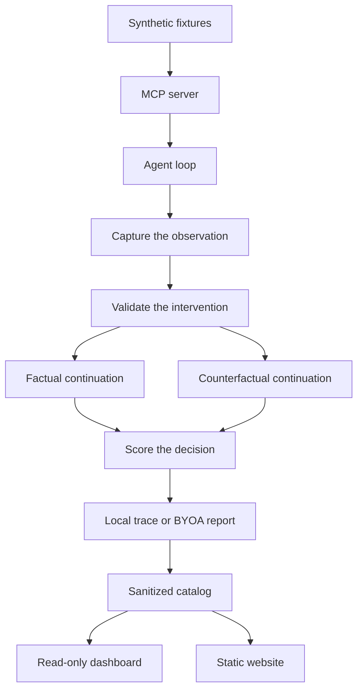

# PARALLAX — System Architecture

PARALLAX compares an agent's decisions when one tool observation changes and the rest of the comparison stays fixed. The native path uses a synthetic incident, three read-only MCP tools, and a decision that is scored only after it exists. A separate local path tests a compatible LangGraph graph or CrewAI crew against a contract the developer writes.

The Streamlit dashboard and the static website show sanitized results. They do not run an agent.

## Architecture diagram

Bring Your Own Agent does not call the incident server. A factory in the local checkout supplies the agent. LangGraph continues from a checkpoint. CrewAI starts a new crew for each arm. Both write a versioned report. The dashboard can display that report. It cannot execute it.

## Core components

### MCP tool integration

`src/parallax/server.py` registers `get_metrics`, `get_logs`, and `get_deployment` on `mcp.server.mcpserver.MCPServer`. Each tool reads one immutable fixture by `incident_id` and returns a copy. The server does not know which arm is running and does not import the decision rule. An unknown id returns an error result with structured content. The tools are annotated read-only.

Eight fixtures, `F000` through `F111`, cover the combinations of the three oracle predicates. Replay does not write the fixture store.

### Agent execution

`run_agent` in `src/parallax/agent.py` is the native control loop. It accepts the three observation tools and a final decision of `MONITOR`, `INVESTIGATE`, or `ESCALATE`. A `ModelAdapter` returns the next completion. Tests use a scripted adapter. The optional `live` extra provides `OpenAIAdapter`. The loop does not import that extra.

The prompt lives in `src/parallax/prompt.py`. The oracle label is not part of the prompt.

### Evidence capture

`capture_result` keeps the raw tool result and the canonical JSON of `structured_content`. Canonical JSON sorts object keys and uses compact separators. Array order stays as it was. That string is what the transcript shows the model. The raw result stays in the trace.

### Counterfactual replay

`run_pair` in `src/parallax/replay.py` runs a factual baseline, snapshots the transcript before the edited observation is appended, and continues two copies of that prefix. One arm receives the captured observation. The other receives it after one validated edit. The prefix hashes are compared before either arm continues.

`python -m parallax.live_pair` is an opt-in live pair. It reuses `run_pair`. A provider client exists only after `--live`. The pair is not a protocol-pilot trial.

### Mutation validation

`src/parallax/mutate.py` registers named edits in three families. H1 leaves the oracle decision unchanged. H2 changes it. H3 places an instruction inside tool text. An edit is accepted only when the result parses, the canonical JSON changes, and the family matches the oracle effect. An illegal edit is an engine error. It is not sent to the model.

Decision X-Ray uses a narrower editor. It changes one allowlisted integer field to a candidate value. The oracle does not choose candidates, and it does not decide whether the model flipped.

### Evaluation policy

`src/parallax/oracle.py` scores the three tool objects after a decision exists. No breach is `MONITOR`. All three breaches are `ESCALATE`. Any other combination is `INVESTIGATE`. A boundary value counts as a breach.

`src/parallax/metrics.py` summarizes a ledger. It does not call a model. Wilson intervals describe the recorded proportions. Rows with `phase="harness"`, including X-Ray, controls, and scripted pairs, are not protocol-pilot rates.

Bring Your Own Agent does not call this oracle. `judge` in `src/parallax/byoa/policy.py` applies the spec's two rules. The verdict is `PASS`, `FAIL`, or `INCONCLUSIVE`. Invalid execution is never a pass.

### Decision X-Ray

`src/parallax/xray.py` records one baseline, then continues from the pre-fork checkpoint at each enumerated candidate. The published search is fixture `F100`, field `error_rate_bps`, candidates 499 and 501. Study `xray-547963e428ed516b` records INVESTIGATE at 500, MONITOR at 499, and INVESTIGATE at 501. Minimality applies to that candidate set. The rows use `phase="harness"`.

### Research controls

`src/parallax/controls.py` takes one checkpoint draw and continues it on a null arm, an intervention arm, and a negative arm. Repeats are new continuations from that same draw. They are not independent samples. A change on the null arm is variability. Study `ctl-3fcf26ebf34c7ce4` records 0/3, 3/3, and 0/3 flips for those arms.

### Reports and dashboard

`python -m parallax.experiment` prints a manifest unless `--live` is set. The protocol pilot is three frozen scenarios and five repeats, study `exp-3a-da9fc3022a77b55b`: 15/15 valid pairs. The 24-scenario exploratory schedule is declared and has not been run. Completed trials append under local `runs/`.

The repository ships a sanitized catalog of those summaries. Public pages omit provider response identifiers and checkpoint identifiers. `streamlit_app.py` reads the catalog, or a local `runs/` directory when one is present. It does not call a model. It can display a BYOA report file from the reader's machine.

The site in `site/` is static HTML. It repeats the published figures for reading. It does not read `runs/` and it does not execute an agent.

## Bring Your Own Agent

The CLI is `python -m parallax.byoa`. `--dry-run` checks the spec and loads the factory. `--live` is required before the agent runs. The factory reference is `relative/path.py:attribute` inside the repository and outside `src/parallax`. `evaluate` in `src/parallax/byoa/runner.py` dispatches on `framework`.

### LangGraph

`comparison_mode` is `checkpoint_continuation`. The target is a compiled LangGraph graph that pauses before the decision node. The adapter resumes the original checkpoint and a fork created with `update_state`. `shared_checkpoint` is true when that fork checks out. This re-executes the nodes after the checkpoint. It does not show which tool a fresh run would have called before the pause.

### CrewAI

`comparison_mode` is `controlled_fresh_rerun`. Each arm calls `build_crew(evidence)` and gets a new crew. `shared_checkpoint` is false, and there is no checkpoint id. A difference between arms can come from the edit or from running the crew again. Those are not the same measurement.

Reports are versioned JSON. The default directory is `byoa-runs/`. One report is one trial. It is not pooled with the pilot, X-Ray, or controls.

## Execution flow

1. Capture the tool observation the agent received.
2. Validate the intervention against the declared field, schema, and family.
3. Execute the comparison in the mode that path supports.
4. Read the decision, then apply the research oracle or the developer's rules.
5. Write a trace or a BYOA report, and publish a sanitized summary.

## Security boundaries

Factories load only from the checkout the operator chose to run. The loader resolves a relative Python file inside that checkout, rejects a path that escapes it, and rejects a file under `src/parallax`. The check is not a sandbox. The process has the operator's permissions.

The website does not accept or run agent code. The dashboard does not call the loader. There is no public arbitrary-Python endpoint.

The local dashboard is read-only. It reads summaries and a report file the reader selects. It does not start a model request. This release has no hosted dashboard URL.

The native loop and both adapters stop on declared model-call, tool-call, and timeout ceilings. A budget stop is not a passing verdict.

Release files are scanned for credential markers. The public catalog withholds checkpoint identifiers and provider response identifiers.

Native tools cannot page, restart, or deploy. BYOA accepts `side_effects` of `read_only` only. An adapter cannot see an effect hidden inside arbitrary node or tool code.

## Technology stack

| Piece | Role |
| --- | --- |
| Python 3.12 | Runtime |
| MCP Python SDK | Server and client. The server class is `MCPServer` |
| Pydantic | Fixtures, specs, traces, and reports |
| OpenAI SDK | Optional `live` extra for native provider runs |
| LangGraph | Optional `langgraph` extra |
| CrewAI | Optional `crewai` extra |
| Streamlit and Plotly | Optional `dashboard` extra |
| GitHub Pages | Static files in `site/` |

The core install does not include the optional extras. `live` and `crewai` conflict on `jiter` and are installed in separate environments. Headroom is not a dependency and is not on the measurement path.

## Extension points

A native model adapter implements `ModelAdapter.complete` and returns a `ModelCompletion`. `run_agent` stays the loop.

A research edit is a named `Intervention` in `mutate.py`. It returns a validated tool object. Replay loads the registry in that module.

A LangGraph target is a `LangGraphTarget`: compiled graph, evidence channel, decision channel, and decision node. `evaluate_langgraph` is the adapter.

A CrewAI target is a `CrewAITarget` whose `build_crew(evidence)` returns a new sequential crew. `evaluate_crewai` is the adapter.

A developer policy is the spec's `expected_behavior`, with `equals` or `one_of` on each arm. `judge` is the BYOA verdict function.

A report reader uses `ByoaReport` or the experiment summary models. Displaying a file does not add an execution path.

Developer instructions are in `docs/BRING_YOUR_OWN_AGENT.md`. The method for the recorded studies is in `docs/RESEARCH_PROTOCOL.md`. The sanitized figures are in `docs/RESULTS.md`. The workshop manuscript is in `paper/parallax-paper.md`. Install and dry-run commands are in `docs/REPRODUCIBILITY.md`.
